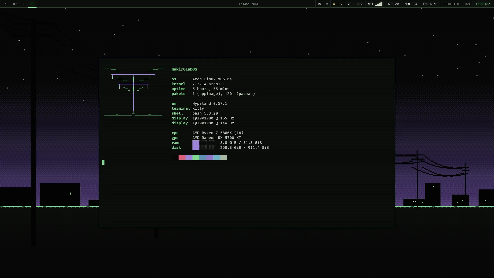
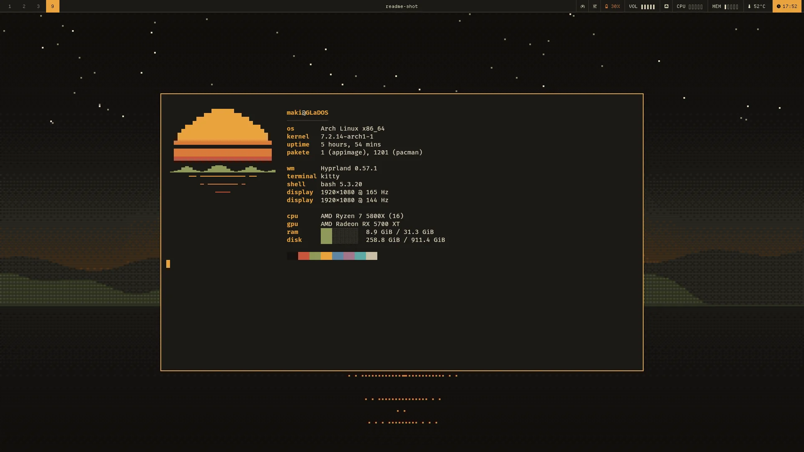
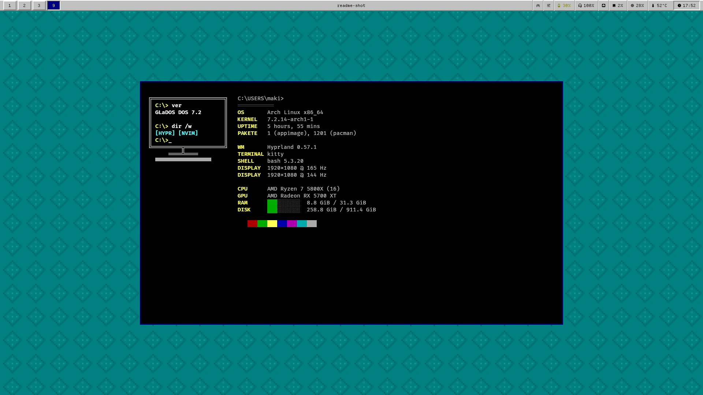
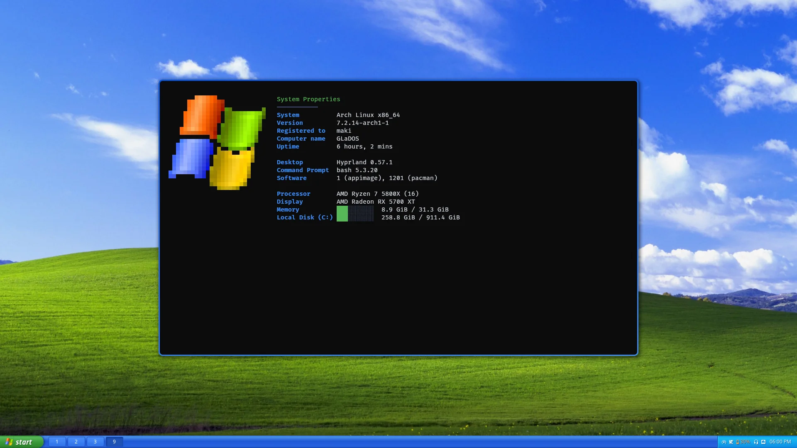
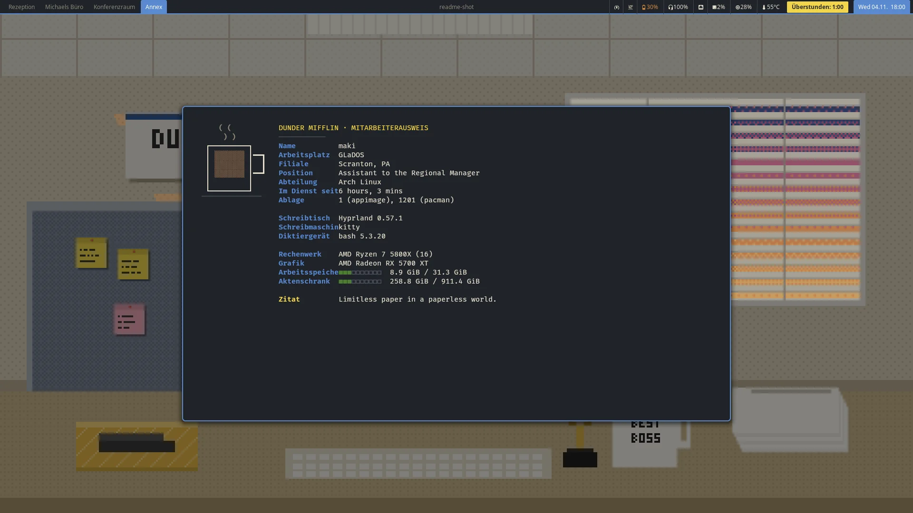
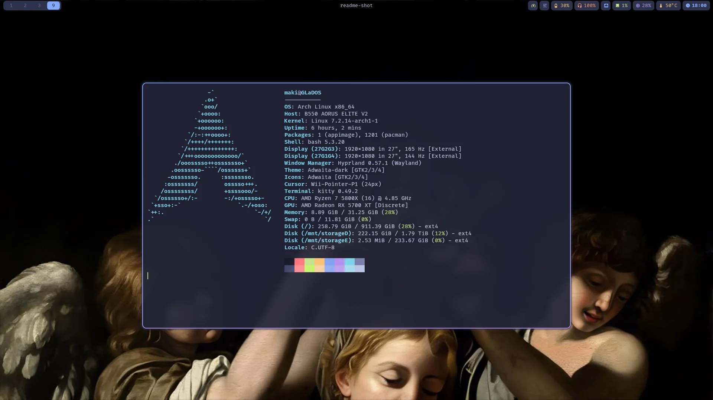

# Dotfiles

Hyprland-Desktop unter Arch Linux mit umschaltbaren Themes. Ein Branch fuer Desktop und Laptop:
Was sich unterscheidet (Monitore, Akku, Leerlauf, Deckel), erkennt `hypr/scripts/hypr-profile.sh`
zur Laufzeit.

## Themes

`theme <name>` stellt alles auf einmal um: Hyprland, Waybar, Kitty, Neovim, Dunst, Sperrbildschirm,
Launcher, Wallpaper (je nach Tageszeit), Mauszeiger, Klaenge, Bildschirmschoner, Browser und
Anmeldebildschirm. Details: [themes/README.md](themes/README.md).

| | |
| --- | --- |
|  **wired**: Lain, Phosphorgruen und Violett, Terminal-Leiste, Strommast |  **retro**: Bernstein-CRT, warmes Schwarz, Creme, Bernstein |
|  **win31**: Windows 3.1, Teal-Desktop, Systemgrau, DOS-Terminal |  **winxp**: Windows XP (Luna), Taskleiste unten, eigenes Startmenue |
|  **office**: The Office, Raeume als Workspaces, Feierabend-Zaehler, Zitate |  **tokyonight**: runde Ecken, Blur, Pill-Leiste |

Die Screenshots zeigen die Themes mit eigenen Bildern, Logos und Klaengen (z. B. Bliss und die
XP-Logos). Diese Dateien liegen je Theme in `private/` und sind nicht im Repo; ohne sie nutzt jedes
Theme eigene Zeichnungen. Welche Dateien wohin gehoeren: `themes/winxp/PRIVAT.md`,
`themes/office/PRIVAT.md` und fuer Wallpaper `themes/README.md`.

## Aufbau

| Ordner | Inhalt |
| --- | --- |
| `hypr/` | Hyprland (Lua-Config), hypridle, hyprlock, Laptop-Profil: [hypr/README.md](hypr/README.md) |
| `themes/` | die Themes, je ein Ordner mit denselben Dateien |
| `waybar/`, `kitty/`, `dunst/`, `fastfetch/` | Leiste, Terminal, Benachrichtigungen, Systeminfo |
| `nvim/` | Neovim mit lazy.nvim: [nvim/README.md](nvim/README.md) |
| `bin/` | eigene Skripte (`theme`, `theme-setup`, `backup-check`, `dotfiles-check`, ...): [bin/README.md](bin/README.md) |
| `systemd/user/` | Dienste der Hyprland-Sitzung, Backups, Timer |
| `bash/`, `git/` | Shell- und Git-Grundeinstellungen |
| `uwsm/env`, `pacman/makepkg.conf`, `gtk-3.0/gtk.css` | Session-Variablen, AUR-Builds mit allen Threads, Thunar-Styling |

Die `.gitignore` ist eine Whitelist: Alles andere in `~/.config` bleibt ausserhalb des Repos.

## Einrichtung

Voraussetzung: Arch Linux mit Hyprland 0.57 und uwsm. Welche Programme fehlen, zeigt
`bin/theme-setup --check`.

```sh
cd ~/.config
git init -b master
git remote add origin git@github.com:markuspetzke/dotfiles.git
git fetch origin
git checkout -f -t origin/master   # ueberschreibt gleichnamige Dateien in ~/.config
bin/theme-setup                    # Skripte, Bash, Schrift, Dienste, Theme; meldet, was noch fehlt
```

## Pruefung

Vor jedem Commit prueft `bin/dotfiles-check` Lua, Shell, Python, JSON, systemd-Units und die laufende
Hyprland-Config (Git-Hook in `.githooks/`, `theme-setup` aktiviert ihn). So landet keine kaputte
Config auf einem anderen Rechner. Von Hand: `dotfiles-check`.
